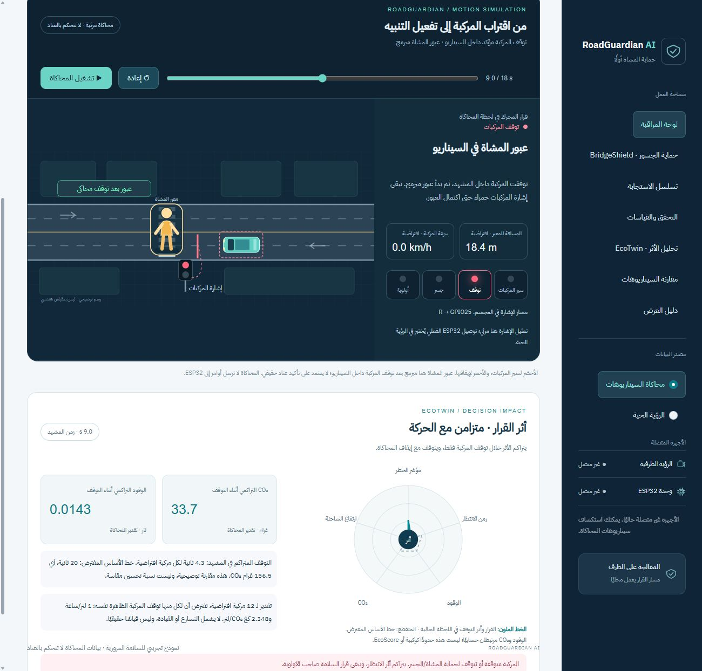

# RoadGuardian AI — Pedestrian Safety & ESP32 Demonstrator

RoadGuardian is a traffic-safety prototype with an Arabic, right-to-left dashboard. Its primary demonstration, **SafeCross**, illustrates pedestrian warnings; **BridgeShield** demonstrates overheight-vehicle warnings. **EcoTwin** estimates fuel use and CO₂ from simulated vehicle waiting time.

The local vision pipeline uses pretrained YOLOv8n for object detection and tracking, followed by a deterministic decision engine and serial commands to ESP32 LEDs. The project does not include a custom-trained detection model.

**This is an educational prototype, not a safety-certified system.** It does not control real traffic signals, authorize pedestrian crossing, or establish collision-prevention performance.

[Try the browser demo](https://ey4d55.github.io/RoadGuardian-AI/) · [Validation and limitations](docs/validation.md) · [Hardware setup — العربية](docs/hardware.md)



## What you can run

| Component | Capabilities | Requirements |
|---|---|---|
| Browser demo | Six animated scenarios and illustrative EcoTwin calculations | Web browser |
| Local dashboard | Simulation playback, live-status display, response simulator, manual validation records and CSV export | Python and dashboard dependencies |
| Local vision | Person, car and truck detection; separate presence and tabletop stop-line experiments | Camera, YOLO dependencies and downloaded weights |
| ESP32 demonstrator | LED outputs, command acknowledgments and a two-second fallback to red | ESP32, USB connection, LEDs and resistors |

The browser demo has no camera or ESP32 connection. Dashboard simulations do not send hardware commands. The live pipeline runs separately on the local computer.

## Quickstart

Install **Python 3.11 or newer**, clone or download this repository, and open a terminal in its root directory. No camera, ESP32 or model weights are needed for the dashboard simulation.

**Windows PowerShell:**

```powershell
python -m venv .venv
.\.venv\Scripts\python.exe -m pip install -r requirements-dashboard.txt
.\.venv\Scripts\python.exe -m streamlit run dashboard.py --global.developmentMode false --server.address 127.0.0.1 --server.port 8502
```

**Linux / macOS:**

```bash
python3 -m venv .venv
.venv/bin/python -m pip install -r requirements-dashboard.txt
.venv/bin/python -m streamlit run dashboard.py --global.developmentMode false --server.address 127.0.0.1 --server.port 8502
```

Open <http://127.0.0.1:8502>, choose a scenario and select **تشغيل المحاكاة**. Playback supports pause, reset and a timeline; EcoTwin follows the same simulation clock. The interface is in Arabic. Hardware observations so far were made on Windows; Linux and macOS camera/serial operation has not been verified.

## Camera and ESP32

Follow the [hardware guide](docs/hardware.md) for dependencies, model download, wiring, serial checks and camera modes. Activate the virtual environment before using the guide's `python` commands.

The tested board is a NodeMCU ESP-32S with a USB connection. `--camera` selects a camera device exposed to the local computer; the firmware is not an ESP32-CAM video server. Camera images and device status are shared locally through `edge_status.json`.

| Command | Demo output |
|---|---|
| `R` | Red LED on GPIO25 |
| `B` | Red on GPIO25 and bridge-warning LED on GPIO26 blinking at 2 Hz |
| `E` | Emergency-priority LED on GPIO27 |
| `G` | Normal-mode LED on GPIO33 |

The firmware starts in `R` and returns to it after two seconds without a valid command. An acknowledgment confirms that the firmware received the command; it does not verify the physical LED output or a road signal.

## Validation status

Software tests cover decision boundaries and priorities, geometry, serial reconnects and acknowledgments, simulated camera failures, dashboard behavior, simulation exports and EcoTwin calculations. They use fake devices rather than real hardware or YOLO inference.

The retained hardware observations from **22–23 October 2026** report successful red/bridge-warning outputs, person-presence checks and a toy-car stop-line experiment from a suitable camera angle. These observations do not establish detection accuracy, false-negative rates or end-to-end alert latency. Combined pedestrian/vehicle protection, reliable detection from all toy-car angles, an independent height sensor and fully disconnected operation with the phone camera remain unverified.

The [validation record](docs/validation.md) distinguishes reported hardware observations, software checks and outstanding measurements. Decision-engine risk scores are heuristic policy values, not calibrated collision probabilities. Ambulance recognition is simulated; the live model does not identify ambulances as a separate class.

## EcoTwin assumptions

EcoTwin estimates idle fuel use and CO₂:

```text
vehicle_seconds = sum(each vehicle's simulated waiting time)
fuel_litres = vehicle_seconds / 3600 × idle_litres_per_hour
co2_kg = fuel_litres × co2_kg_per_litre
```

The animation uses only the drawn vehicles: one in individual scenes and six in congestion. Its comparison reference assumes all scene vehicles idle for the full 18-second window. The default factors, **1.0 L/h** and **2.348 kg CO₂/L**, are illustrative assumptions without a documented fleet-specific basis. The comparison does not demonstrate measured emissions savings. The separate analysis page allows assumption changes; live environmental estimates are unavailable without the required data. EcoTwin does not change safety decisions or send hardware commands.

## Development

With the virtual environment activated and dashboard dependencies installed:

```bash
python review_project.py
python package_release.py
```

The first command runs the software tests and writes [reports/test-summary.json](reports/test-summary.json), including source hashes. The second builds and verifies `RoadGuardian_AI_Edge_Package.zip` and generates `COMPLETE_CODE.md`. Camera frames, calibration files, model weights, dependencies and secrets are excluded from the source package.

See the [contributor guide](CONTRIBUTING.md) for CI, packaging and GitHub Pages updates.

## Project layout

| Location | Purpose |
|---|---|
| `engine.py` | Deterministic warning rules |
| `vision_serial_bridge.py`, `site_geometry.py`, `tabletop_demo.py` | Local vision, calibration and tabletop experiments |
| `esp32_controller.ino`, `hardware_check.py` | LED firmware and serial hardware check |
| `dashboard.py`, `dashboard_visuals.py`, `roadguardian_views.py` | Streamlit interface |
| `traffic_simulation.py`, `safety_workflow.py`, `ecotwin.py` | Simulations and illustrative impact calculations |
| `assets/` | Local styles, HTML components and Arabic fonts |
| `test_*.py`, `.github/workflows/ci.yml` | Software tests and CI |
| `docs/` | Validation, hardware and design documentation; static Pages demo |

Further documentation: [interface design](docs/design.md), [Arabic physical-demo guide](PHYSICAL_DEMO.md), [pedestrian workflow and measurement definitions](PEDESTRIAN_FIRST.md). Printable [QR artwork](docs/images/roadguardian-qr.png) and an [SVG version](docs/roadguardian-qr.svg) link to the browser demo.

## License and third-party components

A project-wide license has not been selected. Bundled fonts have their own license in [assets/FONT-LICENSE.txt](assets/FONT-LICENSE.txt); dependencies and separately downloaded model weights retain their respective terms. See [THIRD_PARTY_NOTICES.md](THIRD_PARTY_NOTICES.md).
