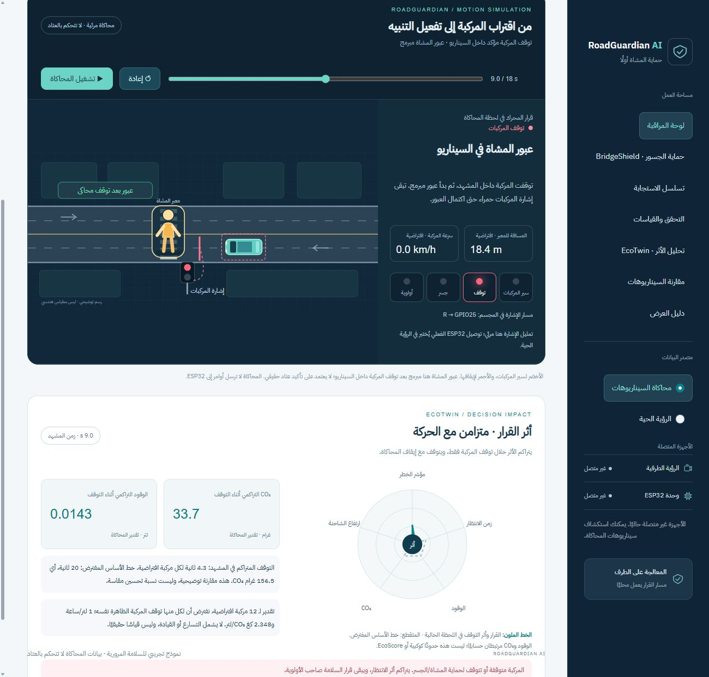

# العرض المنشور

[افتح RoadGuardian AI على GitHub Pages](https://ey4d55.github.io/RoadGuardian-AI/)

نسخة Pages تعرض المحاكاة وEcoTwin داخل المتصفح. الكاميرا وESP32 يعملان في نسخة Python المحلية الموضحة أدناه. ملفات النشر في `docs/`؛ مجلد `dist/` مستبعد ولا يستخدم للنشر. لتحديث المشاهد بعد تعديل المحرك: `python build_pages.py` ثم ارفع التغييرات.

# RoadGuardian AI

منصة نموذج أولي للسلامة المرورية، بواجهة عربية من اليمين إلى اليسار. **SafeCross لحماية المشاة هو التطبيق الرئيسي**، وBridgeShield لحماية الجسور هو التطبيق الثاني. تشمل محاكاة قواعد القرار، ورؤية محلية عبر YOLO، واتصال ESP32، وتحليل EcoTwin افتراضي.



## حالة المشروع — 23 أكتوبر 2026

| الجزء | الحالة الفعلية |
|---|---|
| المحاكاة ومحرك القرار | مختبران آليًا؛ إنذار الجسر أعلى أولوية عند ارتفاع أكبر من 4.5 م |
| كاميرا الجوال وواجهة المراقبة | جُرّب بث محلي مع مربعات كشف وحالة ESP32 |
| اختبار وجود شخص | أكد المستخدم إضاءة الأحمر عند الظهور وانطفاءه عند الغياب |
| السيارة وخط التوقف الافتراضي | أكد المستخدم إضاءة الأحمر عند الاقتراب وانطفاءه عند الرجوع؛ من زاوية مناسبة |
| كشف السيارة اللعبة من الأمام | غير موثوق؛ لا يوجد نموذج مخصص مدرّب |
| حماية مشاة ومركبة معًا في المجسم | مؤجلة إلى تجهيز المجسم بعد التأهل؛ لم تُعتمد ماديًا |
| قياسات المسافة والسرعة | تقديرية؛ أبعاد الدفتر 22×14 سم أدخلها المستخدم، والحدود البصرية لم تُتحقق بمسطرة |
| قياس ارتفاع شاحنة تحت جسر | محاكاة وتقدير بصري برمجي؛ حساس ارتفاع مستقل غير متصل |
| استمرار العرض دون الإنترنت | الاستدلال محلي بعد تحميل الأوزان؛ ربط كاميرا الجوال واختبار الفصل الكامل لم يُعتمدا بعد |

المصابيح تمثّل التحذير في مجسم. لا تتحكم المنصة بإشارة مرور حقيقية ولا تمنح إذن عبور. إقرار Serial يثبت استقبال الأمر فقط؛ التجارب المادية أعلاه مبنية على تأكيد المستخدم وليست قياسات مخبرية للدقة أو زمن الاستجابة.

سيناريو الازدحام المتحرك يضم ست مركبات في اتجاهين، مع توقف وانطلاق، وتوقف الطابور أثناء العبور المبرمج ثم انفراجه تدريجيًا. EcoTwin لهذا المشهد يجمع زمن توقف كل مركبة مرسومة على حدة؛ تستخدم مشاهد المركبة الواحدة مركبة واحدة فقط.

## معاينة لوحة التحكم فقط

Python 3.11 أو أحدث. لا تحتاج الكاميرا أو ESP32 لعرض المحاكاة.

```powershell
python -m venv .venv
.\.venv\Scripts\Activate.ps1
python -m pip install -r requirements-dashboard.txt
python -m streamlit run dashboard.py --global.developmentMode false --server.address 127.0.0.1 --server.port 8502
```

افتح <http://127.0.0.1:8502>. اختر مشهد المحاكاة واضغط «تشغيل المحاكاة»: تتحرك المركبة وتظهر الإشارة وقرار المحرك، مع إيقاف مؤقت وإعادة وشريط زمن. EcoTwin مدمج أسفل المشهد، وله صفحة تحليل مستقلة أيضًا. لا توجد أزرار أحداث متتابعة أو عرض JSON في لوحة القرار. تبقى المحاكاة منفصلة عن أوامر العتاد حتى إذا كان برنامج الرؤية يعمل في نافذة أخرى. المشاة يظهرون بحجم واضح ويتحركون باستيفاء ناعم بين لقطات الحساب: اقتراب ثم انتظار ثم عبور مبرمج بعد توقف المركبة. إشارة سير المركبات خضراء وتبقى حمراء أثناء العبور. هذا التأكيد مبرمج داخل السيناريو، وليس تأكيد وحدة تحكم مادية. القيم الاصطناعية في كل لحظة تمر إلى engine.evaluate نفسه. EcoTwin المدمج يحسب زمن التوقف المتراكم من ساعة الحركة نفسها، ويحسب المركبات المرسومة فقط: واحدة للمشهد الفردي وست للازدحام؛ الإيقاف والإعادة وشريط الزمن تتحكم في الحركة والأثر معًا. صفحة EcoTwin المستقلة تبقى مقارنة افتراضات قابلة للتعديل.

## الرؤية وESP32

```powershell
python -m pip install -r requirements.txt
# أول تشغيل ينزل نموذج YOLO؛ نفذه مع الإنترنت قبل العرض.
python -c "from ultralytics import YOLO; YOLO('yolov8n.pt')"
```

أغلق Arduino Serial Monitor وتطبيق Camera قبل تشغيل الرؤية. يتولى Python فتح الكاميرا والمنفذ، وتقرأ Streamlit أحدث صورة وحالة من `edge_status.json` محليًا. الواجهة ليست متصلة مباشرة بكاميرا ESP32. لا يوجد بث كاميرا عن بُعد أو كاميرا سحابية ضمن هذه النسخة؛ `--camera` يقبل رقم جهاز محلي. إرسال ملف الكود إلى GitHub لا ينقل الكاميرا إليه.

### 1. فحص الصورة والاتصال دون قياسات

```powershell
python vision_serial_bridge.py --preview-only --camera 0 --port COM3 --no-display
```

اختر «الرؤية الحية» في المنصة. الأحمر احترازي ثابت. الصورة داخل الواجهة تُحدّث حتى 5 مرات في الثانية، ويستمر الاستدلال وإرسال الأوامر بمعدل مستقل. لا يُنشأ أرشيف فيديو؛ تُستبدل آخر صورة في ملف الحالة. تُحجب عند توقف التحديثات أكثر من ثانيتين. اضغط Ctrl+C في نافذة Python لإيقافه.

### 2. اختبار ربط وجود شخص

```powershell
python vision_serial_bridge.py --presence-test --camera 0 --port COM3 --no-display
```

شخص مرصود → R؛ غيابه أكثر من ثانية → G. تعطل الصورة أو ظلامها → R. هذا اختبار وجود فقط، لا كشف تصادم ولا سماح عبور.

### 3. اختبار السيارة وخط توقف على الطاولة

انسخ `road_region.example.json` إلى `road_region.json` واضبط زوايا الدفتر الأربع حسب الصورة الحالية، بترتيب: بعيد يسار، بعيد يمين، قريب يمين، قريب يسار بالنسبة لاتجاه الطريق. الإحداثيات بين 0 و1 من عرض الصورة وارتفاعها، وتشمل الهوامش السوداء إن وجدت. `crop` يحدد جزء التحليل، و`length_m` و`width_m` أبعاد الطريق الفعلية بالمتر. الملف المرفق مثال لزاوية جلسة سابقة، وليس معايرة جاهزة لأي كاميرا.

```powershell
python vision_serial_bridge.py --tabletop-test --road-region road_region.json --camera 0 --port COM3 --no-display
```

هذا الوضع يتتبع السيارات والشاحنات فقط. خط التوقف عند 73.3% من طول الطريق؛ التنبيه التجريبي عند مسافة ≤3 سم أو زمن وصول تقديري ≤ثانيتين. فقد التتبع أو قص مربع المركبة أو تعطل الصورة يطلب R احترازيًا. ظهور شخص قد يحجب السيارة فينتج تحذير فقد الرؤية، وليس تصنيف الشخص سيارة. يعرض السبب في الواجهة. لا يطبق `--scene-scale` على هذا الاختبار؛ الأرقام أبعاد المجسم نفسه.

المسافة تُستنتج من مركز أسفل مربع الكشف والتحويل المستوي؛ هذا ليس موضع المصد المؤكد أو كشف تصادم هندسيًا. تغيير زاوية الجوال أو تحريك الدفتر يحتاج إعادة التحديد. الأبعاد وحدها لا تثبت دقة القياس.

### 4. مسار القياس الهندسي للمشاة والجسور

```powershell
python vision_serial_bridge.py --camera 0 --port COM3 --width 640 --height 480 --camera-height-m 0.3 --focal-px 700 --horizon-y 240 --scene-scale 20
```

الأرقام مثال فقط. يلزم تثبيت كاميرا أفقية، أرض مستوية، ومعايرة البعد البؤري والأفق عند نفس الدقة. `--camera-height-m` هو ارتفاع العدسة الحقيقي بالمتر، ولا يُضرب في 20؛ `--scene-scale 20` يحوّل الأبعاد مرة واحدة للحجم المكافئ 1:20. هذا المسار يرفض اختلاف دقة الإطار عن المعايرة. بث الجوال الحالي أعاد 1280×720؛ لا يُعتمد الأمر التوضيحي 640×480 عليه دون معايرة.

يمكن إضافة `--site-config site.json` بعد نسخ وضبط `site.example.json` لتحديد الانتظار والمعبر والاقتراب في الإحداثيات الأرضية. دون المناطق يبقى TTC تقدير تقارب زوج أجسام، ولا يثبت تقاطع المسارات. لا تمثل `road_region.json` بديلًا لملف الموقع الهندسي.

YOLO الحالي يعرف person وcar وtruck، ولا يثبت أن سيارة إسعاف ظهرت. أولوية الإسعاف متاحة في المحاكاة فقط.

## ESP32 والمصابيح

اللوحة المجربة NodeMCU ESP-32S ذات Micro-USB، وليست ESP32-CAM. افتح `esp32_controller.ino` في Arduino IDE؛ إذا طلب وضعه في مجلد بنفس الاسم فوافق. اختر NodeMCU-32S ومنفذ اللوحة، وارفع البرنامج. حزمة ZIP تتضمن أيضًا المجلد الجاهز لفتحه.

| الأمر | المخرج |
|---|---|
| R | الأحمر GPIO25 ثابت |
| B | الأحمر GPIO25 ثابت + تحذير الجسر GPIO26 يومض 2Hz |
| E | أولوية إسعاف تجريبية GPIO27 فقط |
| G | الوضع الطبيعي GPIO33 فقط؛ الأحمر والأولوية مطفآن |

لكل LED مقاومة مستقلة 220–330Ω: GPIO → مقاومة → الرجل الطويلة، والرجل القصيرة → GND. افصل USB قبل تغيير الأسلاك. إذا لم توصل مصباح GPIO33، فإن G يظهر بإطفاء الأحمر فقط. تبدأ اللوحة في R وتعود إليه إذا لم يصل أمر صالح خلال ثانيتين. تعيد Python الاتصال بعد الفصل؛ لا تعني حالة «متصل» إلا استقبال ACK حديث.

```powershell
python hardware_check.py --port COM3
```

هذا الأمر يغيّر مخارج المجسم عمدًا لاختبارها، ويتطلب إغلاق برنامج الرؤية وSerial Monitor. لا تشغلهما على المنفذ نفسه معًا.

## EcoTwin

تحليل افتراضي لانتظار المركبات: الوقود = عدد المركبات × ثواني الانتظار ÷3600 × استهلاك التوقف؛ CO₂ = الوقود × عامل الانبعاث. الافتراضات مرئية وقابلة للتعديل. ليست قياسات حساسات أو نتائج تحسين إشارات مثبتة، ولا توجد قياسات مستقلة للحدود الكوكبية أو NOx وPM2.5. الوحدة لا تغير قرارات السلامة ولا ترسل أوامر للعتاد. الأثر البيئي الحي يظل غير متاح عند غياب البيانات اللازمة.

## التحقق والتصدير

```powershell
python review_project.py
python package_release.py
```

الاختبارات تستخدم أجهزة بديلة، ولا تشغّل الكاميرا أو تومض مصابيح حقيقية. انظر [تقرير المراجعة](ACCEPTANCE_REVIEW.md) للنتائج والحدود و[تجهيز GitHub](GITHUB_READY.md) لقائمة ملفات النشر. يخرج `RoadGuardian_AI_Edge_Package.zip` و`COMPLETE_CODE.md` من قائمة ملفات صريحة، دون الصور المحلية أو بيانات الكاميرا أو مكتبات pip أو الأوزان. GitHub Actions يعيد اختبارات البرمجيات وبناء حزمة المصدر؛ لم يُشغّل عن بُعد حتى رفع المستودع.

خط IBM Plex Sans Arabic مضمن محليًا؛ انظر `assets/FONT-LICENSE.txt` و[مكونات الطرف الثالث](THIRD_PARTY_NOTICES.md). لم يُحدَّد ترخيص عام للمشروع بعد، ولا تُضمّن أوزان YOLO في المستودع.


تصحيح مقارنة EcoTwin: الحساب مرتبط بعدد المركبات المرسومة في جميع المشاهد، مع عرض مجموع مركبة·ثانية ومتوسط CO₂ لكل مركبة. المرجع الموحد هو توقف كل مركبات المشهد طوال نافذة 18 ثانية، وليس تحسنًا مقاسًا. أزيل افتراض 12 مركبة المخفي في المشهد الفردي. سرعة الاقتراب أصبحت 90 بكسل/ثانية في الاتجاهين، مع تباطؤ عند الأحمر وتوقف قبل خط العبور. اختبارات جديدة تتحقق من التناسب مع العدد وعدم تجاوز خط التوقف.
